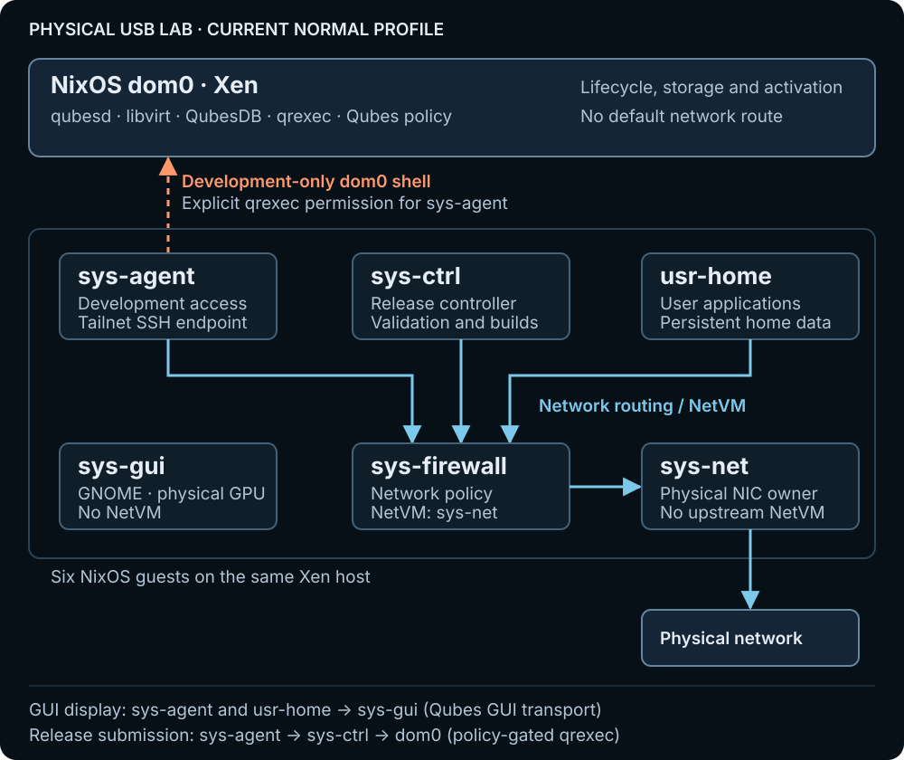

# Architecture

Airlock combines the Qubes architecture with declarative NixOS host and guest
systems. Nix describes system configuration and build inputs; Qubes mechanisms
retain VM lifecycle, inter-VM communication, device ownership, and policy.

## Qubes mechanisms

Xen provides the virtualization foundation. Airlock runs NixOS in dom0 and
preserves qrexec, QubesDB, qubesd, libvirt, and Qubes policy. Guests are built
from NixOS closures, with read-only system content and persistent private data.

The proof of concept accepts existing Qubes runtime state such as `qubes.xml`.
Nix remains the source of truth for declared host/guest systems wherever
practical. Runtime state and generated release records have distinct ownership.

## VM topology

The current USB lab starts sys-gui, sys-agent, sys-ctrl, sys-net, sys-firewall,
and usr-home. The diagram shows this physical development profile, not every
possible Airlock configuration.



[Open the full-size topology diagram](../website/public/diagrams/vm-topology.svg).

Blue arrows show the upstream network path. The dashed orange arrow is the
lab's explicitly permitted `sys-agent` → dom0 development shell; it is not a
network route or a permission granted to every guest.

- **Network:** sys-net owns the physical NICs. Sys-agent, sys-ctrl, and usr-home
  use sys-firewall as their NetVM; sys-firewall uses sys-net. Dom0 has no default
  network route in the normal lab profile.
- **Display:** sys-gui owns the physical desktop GPU and runs GNOME without a
  NetVM. Sys-agent and usr-home display their application windows in sys-gui
  through the Qubes GUI transport; their processes and data stay in their VMs.
- **Deployment:** sys-agent submits committed source to sys-ctrl. Sys-ctrl
  validates and builds candidates and requests admission/activation from dom0
  through the supported, policy-gated qrexec operations. Dom0 retains lifecycle
  and activation authority.

The diagram omits optional experiments and on-demand configuration VMs that
are not part of this normal six-guest topology. Read the
[USB lab guide](usb-lab.md) for remote access and the development boundary.

## Declaration and activation

```text
Nix host and guest declarations
             |
             v
     whole-machine release
             |
             v
     NixOS dom0 / Xen
             |
     Qubes VM lifecycle
             |
     declared NixOS guests
```

This flow shows how Nix declarations become a running machine. The VM topology
above describes the resulting domains and their separate responsibilities.

## Whole-machine releases

The committed development source is submitted through sys-agent to sys-ctrl.
The controller validates and builds candidates, then requests release
preparation and admission. Dom0 owns the shared guest pool, generation
validation, Qubes lifecycle, activation, and recovery records.

Typed status and recovery operations remain available through the supported
deployment client. Selected generations, running generations, pending reboots,
and verified completion are tracked separately. See
[machine deployment](machine-deployment.md),
[pool-backed build storage](sys-agent-build-store.md), and
[generation retention](machine-generation-retention.md).

## Source ownership

`airlock-machine/` is a pinned Git submodule with its own flake and tests. It
owns the deployable machine and runtime implementation. The parent repository
owns image assembly, prepared-store seeding, provisioning, development-host
orchestration, integration tests, documentation, and the website.

Keep implementation changes with their owner and update the parent component
pin after a coherent machine change. See [repository workflow](repositories.md).

## Verification boundaries

Quick tests, Nix builds, nested Xen trials, and physical trials answer different
questions. A build proves an artifact can be produced; physical acceptance
checks the resulting running machine within a named configuration and scope.
See [testing](testing.md) and [validation status](status.md).

The project remains experimental. Preserving Qubes components does not itself
establish the full Qubes OS security model or broad hardware compatibility.
